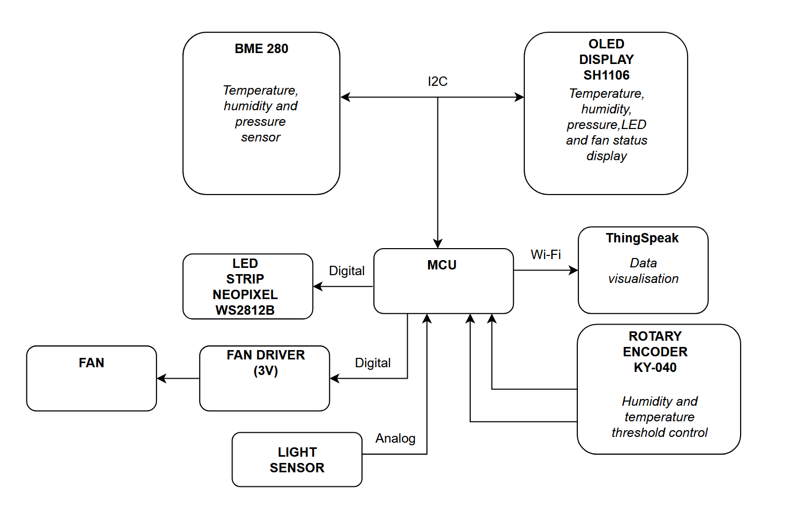
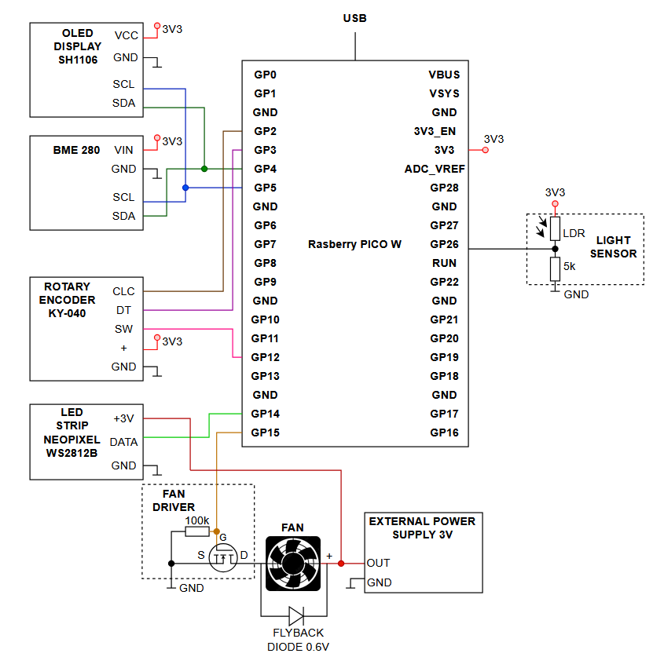

# Smart Greenhouse Monitor (Raspberry Pi Pico W)

[](https://micropython.org/)
[](https://www.raspberrypi.com/products/raspberry-pi-pico-w/)
[](LICENSE)

Embedded systems term project for the **Digital Electronics 2 (DE2)** course at the **Faculty of Electrical Engineering and Communication (FEEC), Brno University of Technology (BUT)**.

---

## Team Members & Responsibilities

| Name | Responsibilities |
|---|---|
| **Adam Koutný** | Block diagram, Wiring diagram, BME sensor, LED display |
| **Ondřej Kovář** | Encoder, Drivers, Main Code |
| **Richard Královský** | Led strip control, Wi-Fi data transmission, Main Code |

---

## Project Overview

### Problem Statement
Maintaining an optimal microclimate inside a greenhouse is essential for healthy plant growth. Sudden temperature spikes or excessive humidity can damage crops or lead to mold and fungal infections. Manual monitoring is time-consuming and often responds too late.

### Solution Summary
The **Smart Greenhouse Monitor** is an automated microclimate control and monitoring unit based on the **Raspberry Pi Pico W** running MicroPython. It:
1. Continuously monitors environmental conditions (temperature, humidity, atmospheric pressure) using an I2C sensor **BME280**.
2. Automatically turns on light (**Light sensor**) after sunset to ensure constant growth.
3. Provides a local visual interface (**OLED display**) showing live measurements and system status.
4. Automatically activates an extraction fan via a MOSFET driver when conditions exceed target thresholds.
5. Allows users to configure temperature, humidity and light setpoints (thresholds) using physical inputs (**Rotary encoder**). 
6. Transmits telemetry data, light and fan status over Wi-Fi to ThingSpeak.

---

## Hardware Inventory & Wiring

### Bill of Materials (BOM)
| Component | Description / Specifications | Interface / Protocol | Supply Voltage |
|---|---|---|---|
| **Raspberry Pi Pico W** | RP2040 microcontroller with 2.4 GHz Wi-Fi | Core controller | 5 V (VBUS) / 3.3 V logic |
| **BME280** | Temperature, Relative Humidity, Pressure sensor | I2C (SDA/SCL) | 3.3 V |
| **Light Sensor** | Ambient light sensor in voltage divider circuit (LDR + 5 kΩ resistor) | Analog (ADC0 / GP26) | 3.3 V |
| **OLED Display SH1106** | 1.3" OLED (SH1106 driver, 128x64 px) | I2C (SDA/SCL) | 3.3 V |
| **Fan** | 3 V DC ventilation fan | Digital switching via MOSFET | External 3 V DC supply |
| **LED Strip NeoPixel WS2812B** | Individually addressable RGB LED strip | Digital data (via neopixel library) | External 3 V DC supply |
| **Fan Driver** | N-channel logic-level MOSFET (e.g. IRLZ44N, 2N7000 or AO3400) + 100 kΩ resistor | Digital GPIO | - |
| **Rotary Encoder KY-040** | Rotary Encoder with integrated push-button for input control | 3x Digital GPIO (internal pull-up) | 3.3 V |
| **External power supply 3 V** | External DC power adapters for the LED strip and extraction fan (3V) | Power rails / DC jack | 3 V |

### Pinout & Wiring Plan

| Pico W Pin | Pin Name / Function | Connected Module & Pin | Notes / Description |
|---|---|---|---|
| **GP2** | GPIO Input | Encoder CLK (A) | Direction & step detection (Pull-up) |
| **GP3** | GPIO Input | Encoder DT (B) | Direction & step detection (Pull-up) |
| **GP4** | I2C0 SDA | BME280 SDA & SH1106 OLED SDA | Shared I2C0 bus data line (pull-up resistors) |
| **GP5** | I2C0 SCL | BME280 SCL & SH1106 OLED SCL | Shared I2C0 bus clock line |
| **GP12** | GPIO Input | Encoder button (SW) | Threshold select button (Pull-up) |
| **GP14** | GPIO | LED Strip Data | NeoPixel LED strip lighting control |
| **GP15** | GPIO | Fan Driver Gate (MOSFET) | Switched 3 V ventilation fan control |
| **GP26** | ADC0 Analog Input | Light Sensor | Ambient light level measurement (0–3.3 V) |
| **3V3** | Pico Power Output | 3.3 V Power Rail | Powers BME280, SH1106 OLED, KY-040, and Light Sensor |
| **3V** | External Power Supply | LED Strip and Fan VCC (+3V) | Dedicated external power for the 3 V LED strip lighting and fan |
| **GND** | Common Ground | System Ground (GND) | Shared common ground for Pico, 3.3 V, 3 V external circuits |

---

## System Architecture & Design

### Block Diagram


### Wiring Diagram


---

## Timing & Concurrency Plan

To achieve a highly responsive user experience (UX), the software abandons blocking `time.sleep()` calls in favor of a **100% non-blocking "superloop"** based on `time.ticks_ms()` paired with **Hardware Interrupts (IRQs)**.

To accommodate the conservative 100 kHz I2C speed without blocking the 100 ms local loop, the OLED display is updated using a "dirty flag" logic (it only redraws when a value physically changes). 

| Task Name | Interval / Trigger | Estimated Duration | Responsibility |
|---|---|---|---|
| `isr_encoder` | On pin change (IRQ) | < 0.1 ms (Microseconds) | Instantly captures rotary encoder rotation (CLK, DT) and button presses (SW) in the background. Sets `display_dirty` flag. |
| `task_local_update` | Every 100 ms | ~ 10 ms (logic only)<br> ~ 90–110 ms (if OLED redraws) | Reads BME280 and LDR sensors, evaluates hysteresis logic for actuators. If data changed or the encoder was moved, it triggers an OLED redraw. |
| `task_telemetry` | Every 20 seconds | ~ 1–3 s (Up to 10 s if reconnecting) | Formats environmental data and uploads it to ThingSpeak via Wi-Fi HTTP POST. *(Note: IRQs ensure encoder inputs are never lost during this blocking network request).* |

---
### Execution Time Breakdown:
* **Sensors & Logic:** The LDR reading uses a 10-sample averaging algorithm via ADC, taking roughly **0.5 ms**. Reading the BME280 via I2C at 100 kHz takes **~10 ms**. Processing the hysteresis logic is nearly instantaneous.
* **OLED Display:** Pushing the frame buffer to the SH1106 OLED via I2C at 100 kHz is the heaviest local task, taking **~80 to 100 ms**. To prevent the 100 ms loop from overflowing continuously, the display is only updated when a value changes.
* **Cloud Telemetry:** Wi-Fi HTTP requests are the main system bottleneck, occupying the processor for **1 to 3 seconds**. Since this only happens every 20 seconds, the local loop maintains a highly responsive user interface.

---

## Repository Structure
```text
DE2-project
├─ docs                         # Sphinx documentation source files
│  ├─ conf.py                   # Sphinx configuration
│  └─ index.rst                 # Documentation root
├─ Images                       # Architecture and wiring diagrams
│  ├─ Block_diagram.png
│  └─ Wiring.png
├─ presentation                 # Poster and demonstration assets
├─ README.md                    # This project report & documentation
├─ src                          # MicroPython production code
│  ├─ config.py                 # Wi-Fi credentials, API keys & threshold defaults
│  ├─ drivers                   # Reusable hardware driver classes
│  │  ├─ actuator.py            # Fan / general digital actuator control (MOSFET)
│  │  ├─ bme280.py              # BME280 I2C temp/humidity/pressure sensor wrapper
│  │  ├─ led_strip.py           # Addressable NeoPixel LED strip controller
│  │  ├─ light_sensor.py        # LDR ADC voltage reader wrapper
│  │  ├─ rotary.py              # KY-040 rotary encoder IRQ handler
│  │  ├─ sh1106.py              # SH1106 OLED display driver and UI wrapper
│  │  ├─ thingspeak_upload.py   # Wi-Fi connection and HTTP POST telemetry
│  │  └─ __init__.py            # Python package initialization
│  └─ main.py                   # Application entry point & non-blocking superloop
└─ tests                        # Component isolation and hardware test scripts
   ├─ test_actuators.py         # Validates Fan MOSFET ON/OFF switching
   ├─ test_bme280.py            # Standalone test for BME280 readings
   ├─ test_i2c_scan.py          # Scans bus for BME280 and OLED addresses
   ├─ test_ldr.py               # Raw LDR voltage measurements
   ├─ test_led_strip.py         # Tests NeoPixel color and brightness control
   ├─ test_LightControl.py      # Tests automated hysteresis logic (LDR -> NeoPixel)
   ├─ test_light_sensor.py      # Validates the light_sensor class wrapper
   ├─ test_oled.py              # Validates UI layout, menu states, and cursors
   └─ test_tsupload.py          # Verifies Wi-Fi connectivity and cloud upload
```
---

## Setup & Installation Instructions

### Prerequisites
1. **Raspberry Pi Pico W** flashed with the latest MicroPython firmware (v1.22 or newer).
2. **Thonny IDE** or **Visual Studio Code (with MicroPico extension)** installed on your computer.

### Quick Start
1. Clone this repository:
   ```bash
   git clone https://github.com/Ondrej-Kovar/DE2-project.git
   ```
2. Connect your Pico W to your computer via USB.
3. Upload files from `src/` to the root filesystem of your Pico W.
4. Run `main.py` directly from your IDE or reset the Pico W to execute automatically on boot.

---

## Testing & Verification


### 1. Sensor Verification (BME280)
- **Module Testing:** Hardware communication and data parsing were successfully verified using the standalone `test_bme280.py` script.

### 2. Fan Driver & Actuation Test
- **Driver switching test:** Verified switching voltage can be 3 V.
- **Hysteresis control:** Fan turns ON when $T > T_{threshold}$ OR $RH > RH_{threshold}$, and turns OFF when both $T < T_{threshold} - \Delta T$ AND $RH < RH_{threshold} - \Delta RH$ to prevent rapid on/off oscillation.

### 3. Automated Light Control (LDR & LED Strip)
- **Logic & Hysteresis validation:** Verified LDR voltage divider readings via ADC with a 10-sample averaging filter. Confirmed that the NeoPixel LED strip correctly toggles based on ambient light without flickering due to software hysteresis.
- **Integration test:** Successfully validated hardware response and software logic using a dedicated test script (`test_LightControl.py`).

### 4. OLED Display
- Verified non-blocking screen updates without stuttering input recognition.
- **Module Testing:** Verified functionality using `test_oled.py` script.

### 5. Cloud Telemetry (ThingSpeak)
- **Wi-Fi & API Connection:** Verified stable network connection and successful HTTP POST requests using the `test_tsupload.py` script.
- **Data Integrity:** Confirmed that local environmental data and actuator states (fan/light) are correctly formatted and accurately visualized on the ThingSpeak cloud dashboard.

---

## Sphinx Documentation

The project includes Sphinx documentation for all custom driver classes and public APIs.

### Building documentation locally:
```bash
cd docs
pip install sphinx sphinx-rtd-theme
make html
```
View the generated output in `docs/_build/html/index.html`.

---

## Presentation & Deliverables

- **Project Poster:** [Link to Poster PDF](presentation/poster.pdf)
- **Demo Video:** [Video Link](https://youtube.com/...)

---

## References & Acknowledgments

- MicroPython documentation: [https://docs.micropython.org/](https://docs.micropython.org/)
- NeoPixel library [https://docs.micropython.org/en/latest/library/neopixel.html#class-neopixel](https://docs.micropython.org/en/latest/library/neopixel.html#class-neopixel)
- Raspberry Pi Pico W documentation: [https://www.raspberrypi.com/documentation/microcontrollers/raspberry-pi-pico.html](https://www.raspberrypi.com/documentation/microcontrollers/raspberry-pi-pico.html)
- DE2 Course lab exercises: [BUT FEEC DE2 MicroPython Labs](https://gitlab.fekt.vut.cz/fryza/micropython-course-labs)