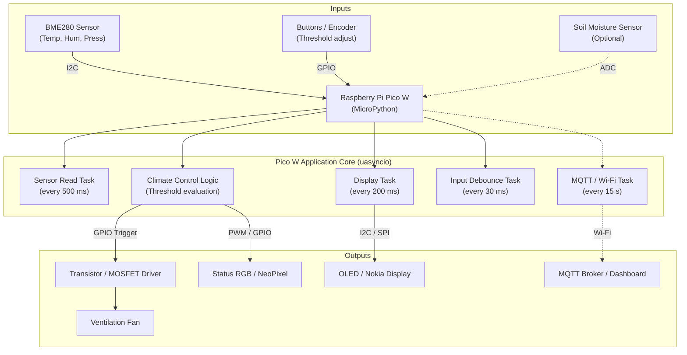

# Smart Greenhouse Monitor (Raspberry Pi Pico W)

[](https://micropython.org/)
[](https://www.raspberrypi.com/products/raspberry-pi-pico-w/)
[](LICENSE)

Embedded systems term project for the **Digital Electronics 2 (DE2)** course at the **Faculty of Electrical Engineering and Communication (FEEC), Brno University of Technology (BUT)**.

---

## 👥 Team Members & Responsibilities

| Name | Role / Focus Area | Key Contributions |
|---|---|---|
| **Adam Koutný** |  |  |
| **Ondřej Kovář** |  |  |
| **Richard Královský** |  |  |

---

## 📖 Project Overview

### Problem Statement
Maintaining an optimal microclimate inside a greenhouse is essential for healthy plant growth. Sudden temperature spikes or excessive humidity can damage crops or lead to mold and fungal infections. Manual monitoring is time-consuming and often responds too late.

### Solution Summary
The **Smart Greenhouse Monitor** is an automated microclimate control and monitoring unit based on the **Raspberry Pi Pico W** running MicroPython. It:
1. Continuously monitors environmental conditions (temperature, humidity, atmospheric pressure) using an I2C sensor **BME280**.
2. Provides a local visual interface (**OLED display & RGB status LED**) showing live measurements and system status.
3. Allows users to configure temperature and humidity setpoints (thresholds) using physical inputs (**rotary encoder**).
4. Automatically activates an extraction fan via a transistor/MOSFET driver when conditions exceed target thresholds.
5. Automatically turns on light after sunset to ensure constant growth
6. Transmits telemetry data over Wi-Fi.

---

## 🛠️ Hardware Inventory & Wiring

### Bill of Materials (BOM)
| Component | Description / Specifications | Interface / Protocol | Supply Voltage |
|---|---|---|---|
| **Raspberry Pi Pico W** | RP2040 microcontroller with 2.4 GHz Wi-Fi | Core controller | 5 V (VBUS) / 3.3 V logic |
| **BME280** | Temperature, Relative Humidity, Pressure sensor | I2C (SDA/SCL) | 3.3 V |
| **Display** | 1.3" OLED (SH1106, 128x64) | I2C  | 3.3 V |
| **Actuator** | 12 V DC ventilation fan | PWM / Digital switching | External DC supply |
| **Actuator Driver** | N-channel MOSFET (e.g. 2N7000 / IRLZ44N) or BJT (2N2222) + flyback diode | Digital GPIO | - |
| **Input Controls** | Rotary Encoder (KY-040) with switch | Digital GPIO (pull-up) | 3.3 V |
| **Status Indicator** | RGB LED with current-limiting resistors | GPIO / PWM | 3.3 V  |
| **Light supply** | LED strip | Analog (ADC0 / GP26) | 5 V |

### Pinout & Wiring Plan
> [!IMPORTANT]
> The Raspberry Pi Pico W uses **3.3 V logic**. Never connect a 5 V or 12 V fan directly to GPIO pins. Always use a driver circuit with a shared common ground (GND).

| Pico W Pin | Function | Connected Module & Pin | Notes / Description |
|---|---|---|---|
| **GP0** | I2C0 SDA | BME280 & OLED SDA | Shared I2C0 bus data line |
| **GP1** | I2C0 SCL | BME280 & OLED SCL | Shared I2C0 bus clock line |
| **GP14** | GPIO Output | Fan Driver Gate / Base | Triggers transistor/MOSFET to power fan |
| **GP16** | GPIO Input | Button 1 (Threshold +) | Internal/External Pull-up |
| **GP17** | GPIO Input | Button 2 (Threshold -) | Internal/External Pull-up |
| **GP18** | GPIO Output | NeoPixel / Status LED | Visual alert for fan active / threshold warning |
| **3V3 (Pin 36)** | Power | 3.3 V rail | Powers BME280, OLED |
| **GND (Pin 38)** | Ground | Common Ground | Common GND between Pico and external power supply |

---

## 🏗️ System Architecture & Design

### Block Diagram



---

## ⏱️ Timing & Concurrency Plan

To keep the system interactive without freezing user input, the software employs cooperative multitasking using MicroPython's **`uasyncio`**:

| Task Name | Interval / Trigger | Priority / Type | Responsibility |
|---|---|---|---|
| `task_inputs` | 20–40 ms | High (Async task) | Scans and debounces button presses / encoder rotation; updates threshold variables. |
| `task_sensors` | 500–1000 ms | Medium (Async task) | Reads raw values from BME280, validates measurement ranges, handles bus errors. |
| `task_control` | 500 ms | Medium (Async task) | Compares current temperature/humidity with setpoint; drives fan output via hysteresis. |
| `task_display` | 200–250 ms | Low/Medium (Async task) | Updates OLED display buffer with latest values and fan status icon. |
| `task_telemetry` | 15–30 s | Background (Optional) | Transmits JSON payloads over Wi-Fi; implements non-blocking reconnection. |

---

## 📁 Repository Structure

```text
├── docs/                       # Sphinx documentation source files
│   ├── conf.py                 # Sphinx configuration
│   ├── index.rst               # Documentation root
│   └── api/                    # Auto-generated or manual class documentation
├── src/                        # MicroPython production code
│   ├── main.py                 # Application entry point & uasyncio task loop
│   ├── config.py               # Hardware pin definitions & default thresholds
│   ├── drivers/                # Reusable component driver classes
│   │   ├── bme280.py           # BME280 I2C driver
│   │   ├── display.py          # Display abstraction (OLED / Nokia)
│   │   ├── fan_controller.py   # Fan PWM / digital driver class
│   │   └── button.py           # Debounced button / input handler class
│   └── lib/                    # Third-party libraries (if any)
├── tests/                      # Component unit / isolation test scripts
│   ├── test_bme280.py          # Standalone sensor test
│   ├── test_fan.py             # Driver circuit validation test
│   └── test_display.py         # Display rendering test
├── presentation/               # Poster and demonstration assets
│   ├── poster.pdf              # Final A3 project poster
│   └── video_link.txt          # Link to 1-2 min demonstration video
├── LICENSE                     # License file (e.g. MIT)
└── README.md                   # This project report & documentation
```

---

## 🚀 Setup & Installation Instructions

### Prerequisites
1. **Raspberry Pi Pico W** flashed with the latest MicroPython firmware (v1.22 or newer).
2. **Thonny IDE** or **Visual Studio Code (with MicroPico extension)** installed on your computer.

### Quick Start
1. Clone this repository:
   ```bash
   git clone https://github.com/Ondrej-Kovar/DE2-project.git
   ```
2. Connect your Pico W to your computer via USB.
3. Upload files from `src/` to the root filesystem of your Pico W.
4. Run `main.py` directly from your IDE or reset the Pico W to execute automatically on boot.

---

## 🧪 Testing & Verification

Document your component verification steps and measured results below:

### 1. Sensor Verification (BME280)
- **Measurement Range Tested:** Temp [°C], Humidity [%RH], Pressure [hPa].
- **Sampling Stability:** Observed sensor noise, calibration offset, and response time when subjected to elevated temperature or humidity.

### 2. Fan Driver & Actuation Test
- **Driver switching test:** Verified switching voltage with multimeter/oscilloscope.
- **Hysteresis control:** Fan turns ON when $T > T_{threshold}$ and OFF when $T < T_{threshold} - \Delta T$ to prevent rapid on/off oscillation.

### 3. Display Refresh Rate & Responsiveness
- Verified non-blocking screen updates without stuttering input recognition.

*(Insert photos, screenshots of serial console, or measurement graphs here)*

---

## 📚 Sphinx Documentation

The project includes Sphinx documentation for all custom driver classes and public APIs.

### Building documentation locally:
```bash
cd docs
pip install sphinx sphinx-rtd-theme
make html
```
View the generated output in `docs/_build/html/index.html`.

---

## 🎥 Presentation & Deliverables

- **Project Poster (A3):** [Link to Poster PDF](presentation/poster.pdf) *(TODO: Add link)*
- **Demo Video (1–2 minutes):** [YouTube / Video Link](https://youtube.com/...) *(TODO: Add video URL)*

---

## 📜 References & Acknowledgments

- MicroPython documentation: [https://docs.micropython.org/](https://docs.micropython.org/)
- Raspberry Pi Pico W documentation: [https://www.raspberrypi.com/documentation/microcontrollers/raspberry-pi-pico.html](https://www.raspberrypi.com/documentation/microcontrollers/raspberry-pi-pico.html)
- Course lab exercises & inspiration: [BUT FEEC DE2 MicroPython Labs](https://github.com/tomas-fryza/esp-micropython)
