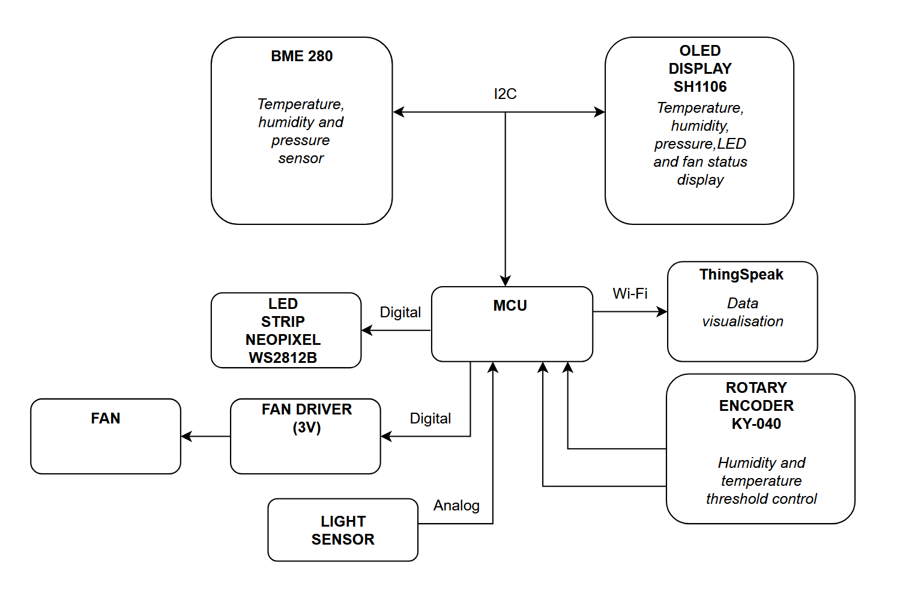
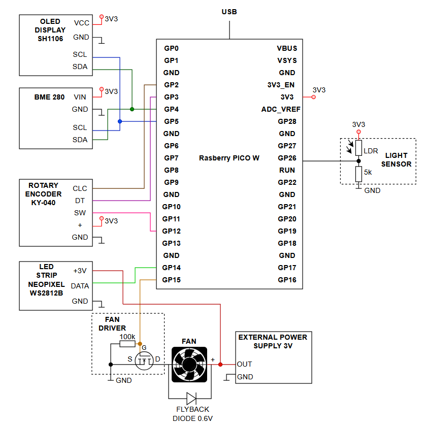

Hardware & Wiring
=================

Block Diagram
-------------

Wiring Diagram
--------------

Pinout & Connections
--------------------

.. list-table:: Raspberry Pi Pico W Pinout
   :header-rows: 1
   :widths: 12 22 28 38

   * - Pico W Pin
     - Function
     - Connected Module
     - Description
   * - **GP2**
     - GPIO Input (IRQ)
     - KY-040 CLK (A)
     - Rotation detection (internal pull-up)
   * - **GP3**
     - GPIO Input (IRQ)
     - KY-040 DT (B)
     - Rotation direction (internal pull-up)
   * - **GP4**
     - I2C0 SDA
     - BME280 & SH1106 OLED
     - Shared I2C0 data line (100 kHz)
   * - **GP5**
     - I2C0 SCL
     - BME280 & SH1106 OLED
     - Shared I2C0 clock line (100 kHz)
   * - **GP12**
     - GPIO Input (IRQ)
     - KY-040 SW
     - Push-button to cycle menu modes (internal pull-up)
   * - **GP14**
     - GPIO Output
     - WS2812B LED Strip
     - NeoPixel data signal (50 LEDs)
   * - **GP15**
     - GPIO Output
     - Fan MOSFET Gate
     - Digital switching of 3 V DC fan (STP36NF06L)
   * - **GP26**
     - ADC0 Analog Input
     - LDR Voltage Divider
     - Ambient light level measurement (0–3.3 V)
   * - **3V3**
     - 3.3 V Power Rail
     - BME280, OLED, KY-040, LDR
     - Logic and sensor supply from Pico W
   * - **3V (Ext.)**
     - External 3 V DC
     - LED Strip & Fan VCC
     - Dedicated external 3 V power supply
   * - **GND**
     - Common Ground
     - All modules
     - Shared ground reference
